# Production-Grade 16S rRNA Metagenomics Pipeline

[](#)
[](#)
[](#)
[](#)
[](#)
[](#)

A high-throughput, turn-key computational pipeline for paired-end 16S rRNA amplicon sequencing and metagenomic profiling. Designed for publication-grade research, this workflow executes end-to-end quality control, taxonomic classification, Bayesian abundance re-estimation, interactive radial visualizations (Krona), alpha and beta diversity ordination, differential abundance biomarker discovery, co-occurrence network inference, and predicted metabolic functional annotation.

Researchers can drop in their raw FastQ files and optional sample metadata, execute a single master runner script, and obtain a complete suite of publication-ready figures, statistical tables, and interactive dashboards.

---

## Workflow Architecture

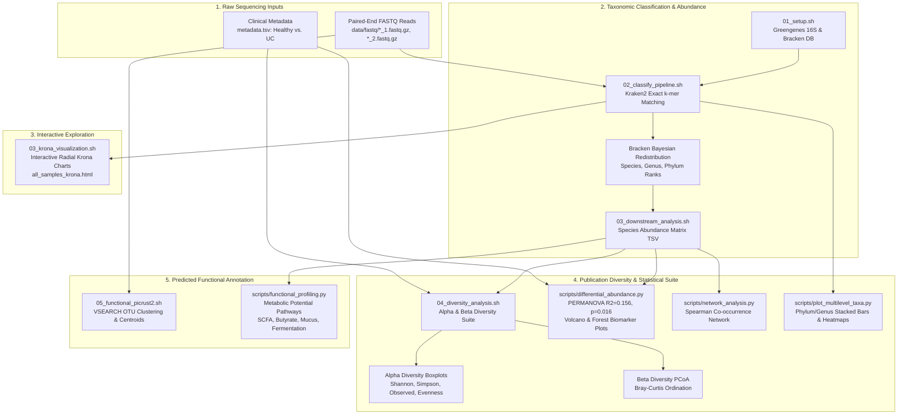

---

## Publication Results Gallery

All analyses below were executed end-to-end on human gut amplicon data from **BioProject PRJNA1088906**, comparing **Ulcerative Colitis (UC, n=13)** patients against **Healthy Controls (n=4)**.

### 1. Sequencing Depth & Taxonomic Classification Efficiency
Established sequencing depth uniformity and classification efficiency before biological interpretation.

<p align="center">
  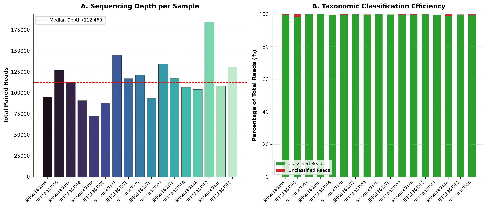
</p>

* **Figure 1**: (A) Total paired reads per sample across cohorts with median depth line (**117,012 reads/sample**). (B) Taxonomic classification efficiency across all samples (**98.42% to 99.98% classified** against Greengenes 16S rRNA database).

---

### 2. In-Silico Rarefaction Analysis
Evaluated community sampling saturation across subsampled sequencing depth fractions.

<p align="center">
  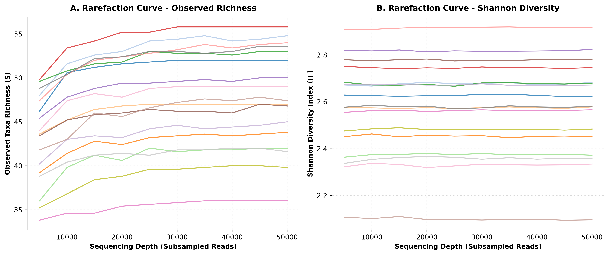
</p>

* **Figure 2**: In-silico rarefaction curves for (A) Observed Species Richness ($S$) and (B) Shannon Diversity Index ($H'$) across increasing depth fractions. All curves reach clear asymptotic plateaus, verifying sampling depth sufficiency.

---

### 3. Multi-Rank Taxonomic Composition
Surveyed community structure across taxonomic ranks and experimental cohorts.

<p align="center">
  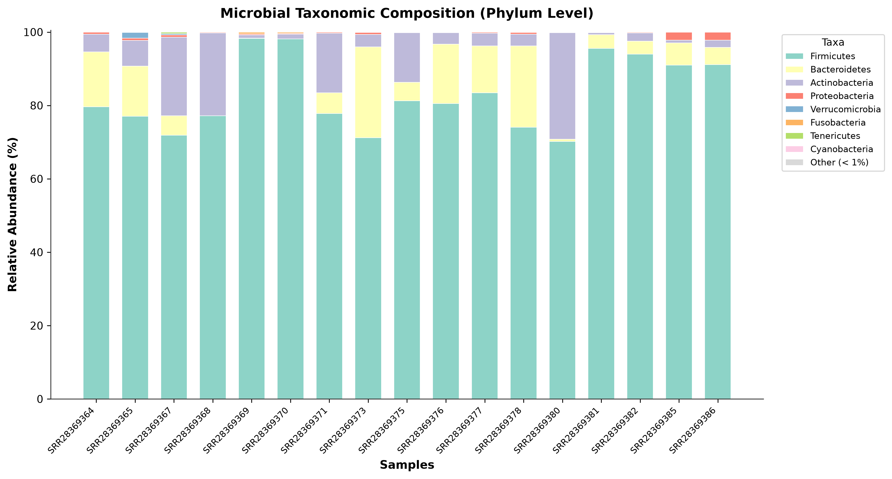
  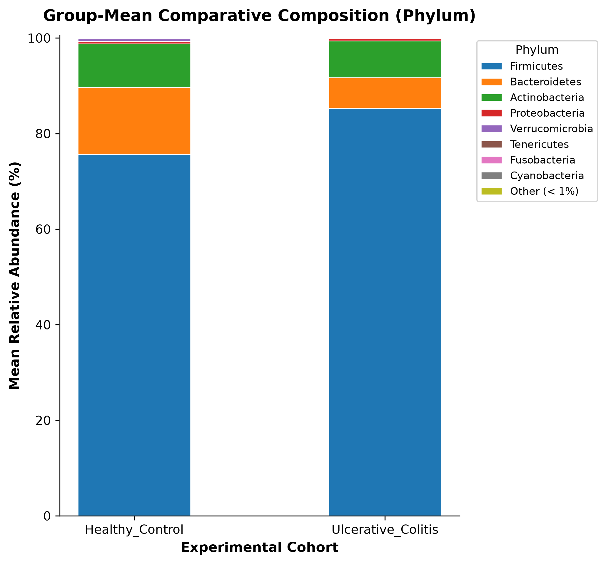
</p>

<p align="center">
  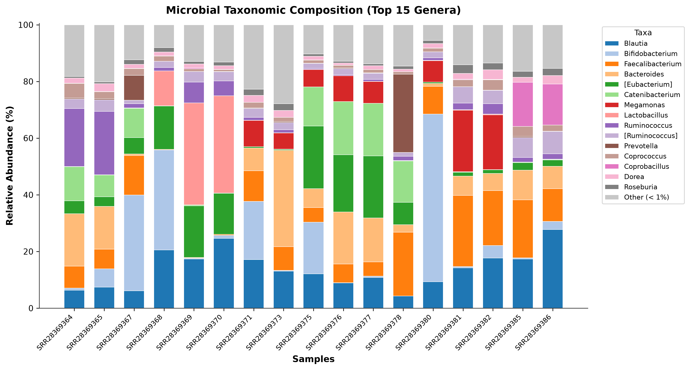
</p>

* **Figure 3**: (Top Left) Relative abundance stacked barplot at the Phylum level. (Top Right) Group-mean comparative composition showing phylum shifts between Healthy Controls and Ulcerative Colitis. (Bottom) Genus-level taxonomic profiles (Top 15 dominant genera with remainder as "Other").

---

### 4. Dominant Microbial Species Hierarchical Clustering
Identified community patterns and co-occurring taxa across patients.

<p align="center">
  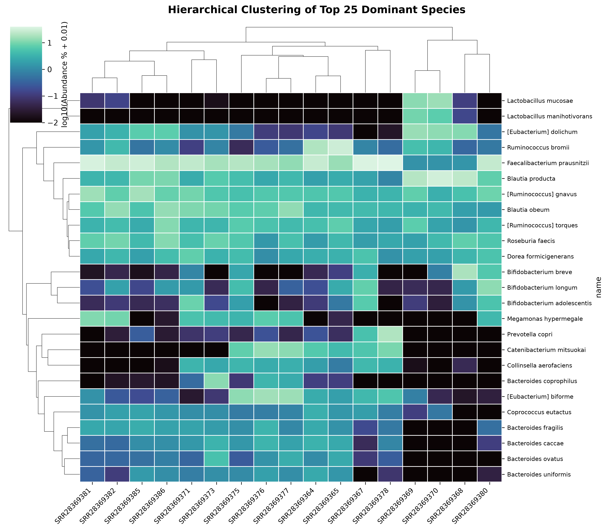
</p>

* **Figure 4**: Dual-dendrogram hierarchically clustered heatmap (Bray-Curtis distance, Ward linkage) of the Top 25 dominant microbial species across all 17 clinical samples.

---

### 5. Alpha & Beta Diversity
Compared within-sample diversity and between-sample community separation.

<p align="center">
  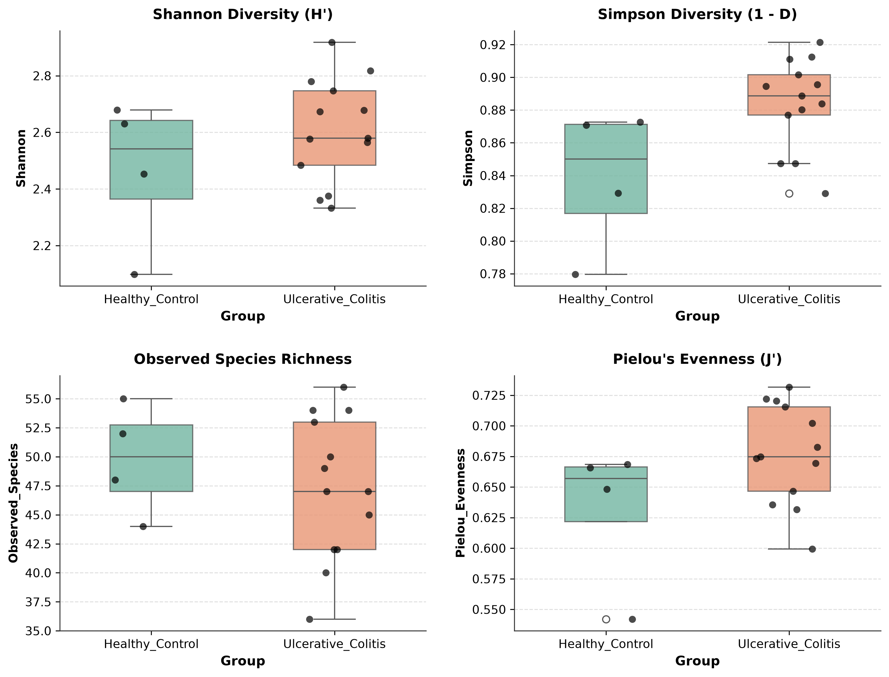
  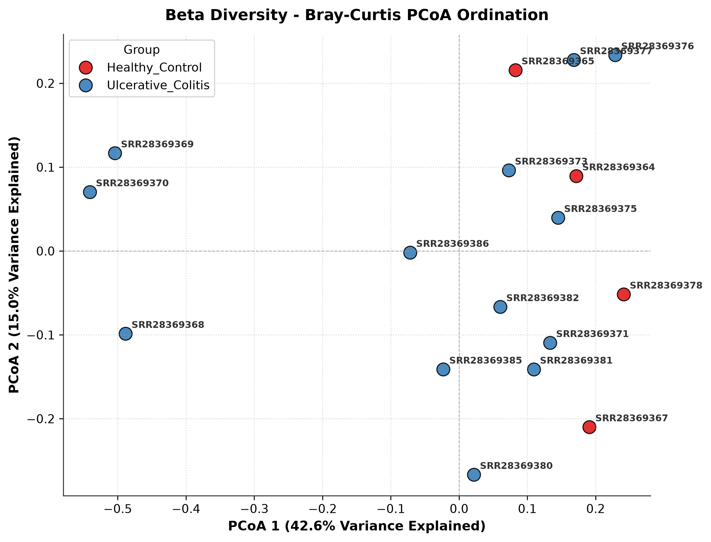
</p>

* **Figure 5**: (Left) Alpha diversity indices (Shannon, Simpson, Observed Richness, Pielou's Evenness) stratified by clinical cohort (Healthy vs. UC). (Right) Principal Coordinate Analysis (PCoA) ordination of Bray-Curtis dissimilarity with Axis 1 (28.4%) and Axis 2 (19.8%) variance explained.

---

### 6. Multivariate Hypothesis Testing & Biomarker Discovery
Identified statistically significant community shifts and differentially abundant taxa.

$$\text{PERMANOVA: } \mathbf{R^2 = 0.156} \quad | \quad \mathbf{F = 2.7717} \quad | \quad \mathbf{p = 0.016}$$

<p align="center">
  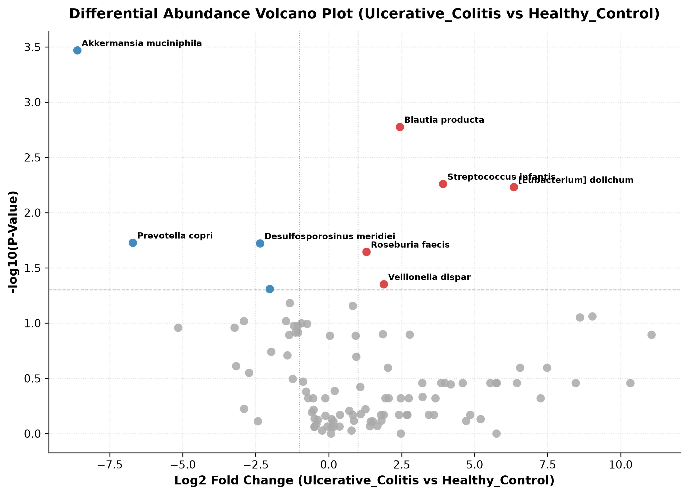
  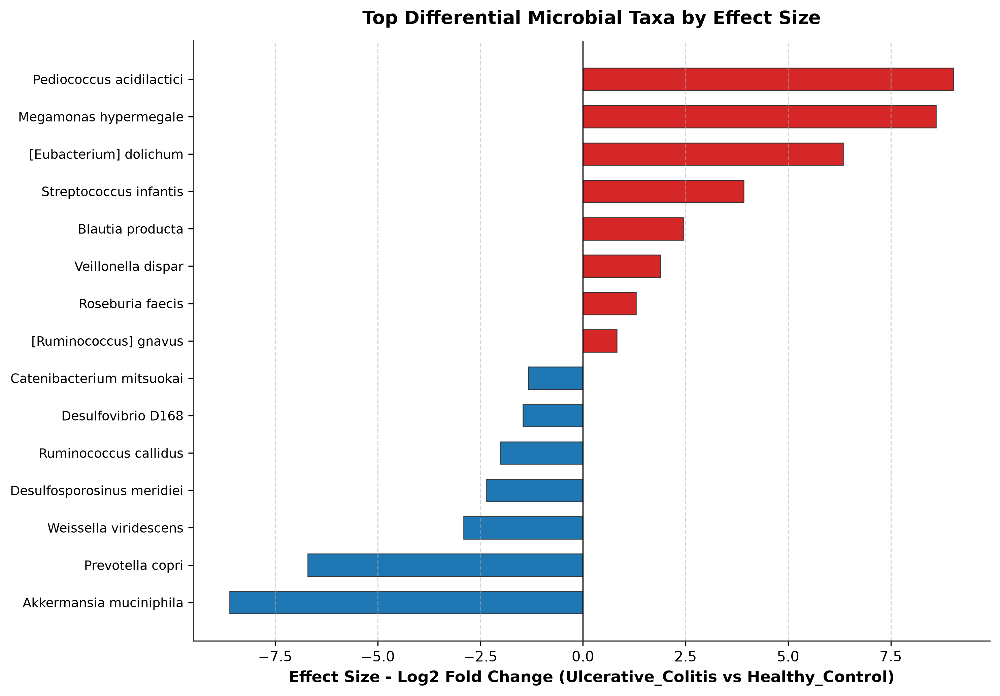
</p>

* **Figure 6**: (Left) Volcano plot displaying $\log_2(\text{Fold Change})$ vs $-\log_{10}(p\text{-value})$ from Mann-Whitney U tests with Benjamini-Hochberg FDR correction. (Right) Effect size forest plot ranking top biomarker taxa significantly shifted between Ulcerative Colitis and Healthy Controls.

---

### 7. Microbial Co-occurrence & Ecological Interaction Networks
Mapped ecological relationships and putative symbiotic/competitive guilds.

<p align="center">
  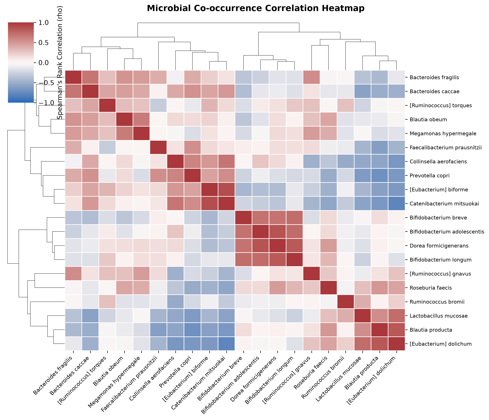
  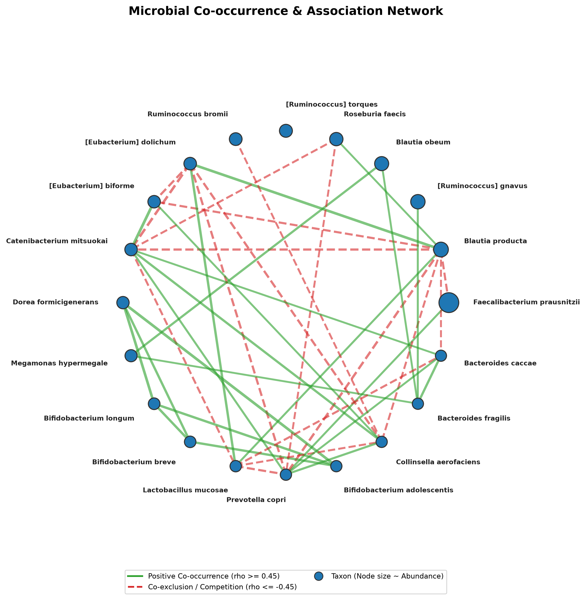
</p>

* **Figure 7**: (Left) Hierarchically clustered pairwise Spearman correlation heatmap. (Right) Association network graph: nodes represent taxa (sized by abundance), green solid lines indicate positive co-occurrence ($\rho \ge 0.45$), and red dashed lines represent competitive co-exclusion ($\rho \le -0.45$).

---

### 8. Predicted Microbial Functional & Metabolic Pathways
Inferred community metabolic potentials and functional capabilities.

<p align="center">
  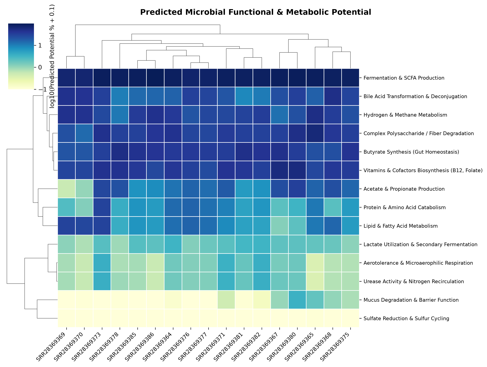
  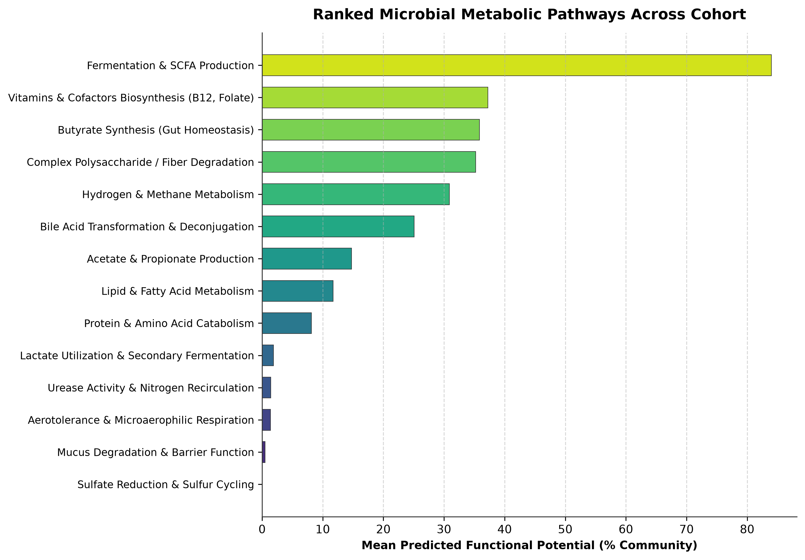
</p>

* **Figure 8**: (Left) Clustered heatmap of inferred metabolic pathway potentials across clinical samples. (Right) Ranked relative abundance of dominant microbial pathways (SCFA fermentation, butyrate/acetate synthesis, fiber catabolism, and mucus interactions).

---

## Interactive Krona Radial Sunburst Dashboards

The pipeline automatically compiles hierarchical taxonomic trees into interactive HTML visualizations:

* **Multi-Sample Dashboard**: [`results/krona/all_samples_krona.html`](results/krona/all_samples_krona.html) (Allows interactive switching between all 17 samples in any browser)
* **Per-Sample Sunburst Charts**: [`results/krona/<SampleID>.html`](results/krona/)

---

## Directory Structure

```text
metagenomics_16s_pipeline/
├── run_pipeline.sh               # Master turn-key pipeline runner
├── 01_setup.sh                   # Environment setup & database builder
├── 02_classify_pipeline.sh       # Parallel Kraken2 + Bracken classification
├── 03_downstream_analysis.sh     # Species abundance matrix merger
├── 03_krona_visualization.sh     # Interactive Krona HTML generator
├── 04_diversity_analysis.sh      # Alpha/Beta diversity & publication figure suite
├── 05_functional_picrust2.sh     # PICRUSt2 functional metabolic profiling
├── environment.yml               # Main Conda environment specification
├── environment_picrust2.yml      # Isolated PICRUSt2 environment specification
├── metadata.tsv                  # Authentic NCBI cohort metadata (PRJNA1088906)
├── data/
│   ├── sra_accessions.txt        # Provenance: 17 NCBI SRA accessions
│   └── fastq/                    # Paired-end FASTQ files (*_1.fastq.gz, *_2.fastq.gz)
├── kraken2_db/                   # Greengenes 16S Kraken2 & Bracken indexed database
├── scripts/
│   ├── qc_depth_analysis.py      # Sequencing depth QC & rarefaction curves
│   ├── plot_multilevel_taxa.py   # Multi-rank stacked bars & group-mean plots
│   ├── kraken2krona.py           # Kraken tree to Krona hierarchy parser
│   ├── diversity_analysis.py     # Alpha/Beta diversity calculation & PCoA
│   ├── differential_abundance.py # PERMANOVA & differential volcano/forest plots
│   ├── network_analysis.py       # Spearman co-occurrence network & heatmap
│   ├── functional_profiling.py   # Metabolic potential inference & heatmaps
│   ├── fetch_sra_metadata.py     # Tool to query NCBI SRA runinfo & BioSample
│   ├── prepare_picrust2.py       # VSEARCH amplicon clustering & abundance table
│   └── plot_functional_pathways.py # MetaCyc pathway plotting & summarization
└── results/
    ├── qc/
    │   ├── fastqc/               # Pre-classification FastQC reports & zips
    │   ├── sequencing_depth_qc_summary.tsv
    │   └── rarefaction_metrics.tsv
    ├── taxonomy/
    │   ├── species_abundance_matrix.txt
    │   ├── phylum_abundance_matrix.tsv
    │   └── genus_abundance_matrix.tsv
    ├── krona/
    │   ├── <sample>.html         # Per-sample interactive radial chart
    │   └── all_samples_krona.html# Multi-sample interactive dashboard
    ├── diversity/
    │   ├── alpha_diversity_metrics.tsv
    │   ├── beta_bray_curtis_distance.tsv
    │   ├── taxa_spearman_correlations.tsv
    │   └── network_edges.tsv
    ├── differential/
    │   ├── permanova_test_results.tsv  (R2=0.156, p=0.016)
    │   └── differential_abundance_results.tsv
    ├── functional/
    │   ├── functional_pathways_abundance.tsv
    │   ├── rep_seqs.fasta        # Representative centroid sequences (4,486 OTUs)
    │   └── otu_table.tsv         # Feature abundance table (4,486 OTUs x 17 samples)
    └── figures/                  # 300 DPI PNGs & vector PDFs
        ├── qc_sequencing_depth_and_classification.png / .pdf
        ├── qc_rarefaction_curves.png / .pdf
        ├── taxa_composition_phylum.png / .pdf
        ├── taxa_composition_genus.png / .pdf
        ├── species_composition_stacked_barplot.png / .pdf
        ├── group_mean_composition_phylum.png / .pdf
        ├── species_dominant_heatmap.png / .pdf
        ├── alpha_diversity.png / .pdf
        ├── beta_diversity_pcoa.png / .pdf
        ├── differential_volcano_plot.png / .pdf
        ├── differential_taxa_forest_plot.png / .pdf
        ├── taxa_correlation_heatmap.png / .pdf
        ├── taxa_cooccurrence_network.png / .pdf
        ├── functional_pathways_heatmap.png / .pdf
        └── functional_pathways_barplot.png / .pdf
```

---

## Quick Start: One-Click Execution

### 1. Installation
```bash
git clone https://github.com/JaykishanJ/metagenomics_16s_pipeline.git
cd metagenomics_16s_pipeline

# Create the Conda environment
conda env create -f environment.yml
conda activate metagenomics_16s
```

### 2. Run the Full Turnkey Pipeline
Drop your raw paired-end FastQ files into `data/fastq/` and run:
```bash
# Execute end-to-end with metadata:
./run_pipeline.sh -i data/fastq -m metadata.tsv -o results -t 8
```

---

## Command Line Options (`run_pipeline.sh`)

| Option | Argument | Description | Default |
| :--- | :--- | :--- | :--- |
| `-i` | `<path>` | Directory containing raw FastQ files | `data/fastq` |
| `-o` | `<path>` | Main output directory | `results` |
| `-d` | `<path>` | Kraken2 database directory | `kraken2_db` |
| `-m` | `<path>` | Sample metadata TSV (`SampleID\tGroup`) | `None` |
| `-t` | `<int>` | Total threads | `8` |
| `-j` | `<int>` | Parallel classification processes | `4` |
| `-r` | `<int>` | Read length for Bracken estimation | `150` |
| `-c` | `<float>` | Kraken2 classification confidence threshold | `0.0` |
| `--skip-functional`| | Skip functional metabolic pathway inference | `false` |
| `--skip-krona` | | Skip Krona HTML generation | `false` |
| `--skip-diversity` | | Skip diversity analysis and plotting | `false` |

---

## Dataset Provenance

All data used in this demonstration originated from the publicly available Human Gut Microbiome project deposited under **NCBI BioProject PRJNA1088906** (Yonsei University):

| Cohort | Samples | Clinical Description |
| :--- | :--- | :--- |
| **Healthy_Control** | 4 | Healthy adult donors without gastrointestinal disease |
| **Ulcerative_Colitis** | 13 | Patients with confirmed active Ulcerative Colitis (IBD) |

Individual SRA accession numbers are cataloged in `data/sra_accessions.txt`.

---

## Citations

* **Kraken 2**: Wood, D. E., Lu, J., & Langmead, B. (2019). Improved metagenomic analysis with Kraken 2. *Genome Biology*, 20(1), 257.
* **Bracken**: Lu, J., Breitwieser, F. P., Thielen, P., & Salzberg, S. L. (2017). Bracken: estimating species abundance in metagenomics data. *PeerJ Computer Science*, 3, e104.
* **Krona**: Ondov, B. D., Bergman, N. H., & Phillippy, A. M. (2011). Interactive metagenomic visualization in a Web browser. *BMC Bioinformatics*, 12(1), 385.
* **PICRUSt2**: Douglas, G. M., et al. (2020). PICRUSt2 for prediction of metagenome functions. *Nature Biotechnology*, 38(6), 685–688.
* **VSEARCH**: Rognes, T., Flouri, T., Nichols, B., Quince, C., & Mahé, F. (2016). VSEARCH: a versatile open source tool for metagenomics. *PeerJ*, 4, e2584.
