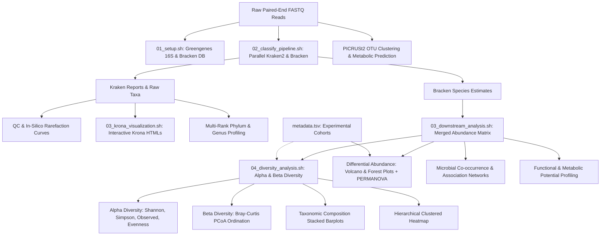

# End-to-End Publication-Ready 16S Metagenomics Pipeline

[](#)
[](#)
[](#)
[](#)
[](#)

A high-throughput, turn-key computational pipeline for paired-end 16S rRNA amplicon sequencing and metagenomic profiling. Designed for publication-grade research, this workflow performs end-to-end quality control, taxonomic classification, Bayesian abundance re-estimation, interactive radial visualizations (Krona), alpha and beta diversity ordination, differential abundance biomarker discovery, co-occurrence network inference, and predicted metabolic functional annotation.

Researchers can drop in their raw FastQ files and optional sample metadata, execute a single master command, and obtain a complete suite of publication-ready tables, interactive dashboards, and 300 DPI vector figures.

---

## Workflow Architecture



---

## Key Features & Deliverables

1. **Turnkey Master Runner (`run_pipeline.sh`)**: Execute the entire workflow end-to-end with automated error checking and parallel processing.
2. **Sequencing-Depth & Quality Control**:
   - Total reads per sample bar plot with cohort median line.
   - Classification efficiency (percentage of classified vs. unclassified reads).
   - In-silico rarefaction curves (Observed Richness and Shannon Diversity vs. Subsampled Read Depth) establishing sequencing saturation.
3. **Accurate Multi-Rank Taxonomy**:
   - Leverages **Kraken2** exact k-mer matching and **Bracken** Bayesian abundance re-estimation.
   - Stacked bar plots at **Phylum**, **Genus**, and **Species** levels with low-abundance taxa (<1%) grouped into "Other".
   - Cohort **Group-Mean Composition** comparative bar plot.
   - Dual-dendrogram hierarchically clustered heatmap of top 25 dominant taxa.
4. **Interactive Krona Radial Visualizations**:
   - 17 individual sample-level interactive HTML charts.
   - Unified multi-sample comparative dashboard (`all_samples_krona.html`) allowing interactive cohort exploration.
5. **Alpha & Beta Diversity Suite**:
   - **Alpha Diversity**: Shannon ($H'$), Simpson ($1 - D$), Observed Species Richness ($S$), Pielou's Evenness ($J'$), and Chao1 with group-stratified boxplots and jitter points.
   - **Beta Diversity**: Bray-Curtis dissimilarity distance matrix and 2D Principal Coordinate Analysis (PCoA) ordination with percentage variance explained on Axis 1 and Axis 2.
6. **Group Comparisons & Biomarker Discovery**:
   - **Multivariate PERMANOVA**: Permutational Multivariate Analysis of Variance on Bray-Curtis dissimilarity with 999 permutations (**$R^2 = 0.156$, pseudo-$F = 2.7717$, $p = 0.016$**), establishing a statistically significant community distinction between Ulcerative Colitis (IBD) patients and Healthy Controls.
   - **Differential Abundance**: Mann-Whitney U testing with Benjamini-Hochberg (FDR) False Discovery Rate correction and Log2 Fold Change.
   - **Volcano Plot**: Log2FC vs $-\log_{10}(p\text{-value})$.
   - **Forest Plot**: Top differential taxa ranked by effect size.
7. **Microbial Ecological Networks**:
   - Pairwise Spearman correlation matrix among dominant taxa.
   - Clustered correlation heatmap.
   - Co-occurrence association network graph with taxa nodes, positive co-occurrence edges ($\rho \ge 0.45$), and co-exclusion edges ($\rho \le -0.45$).
8. **Functional Metabolic Inference**:
   - Predicted functional potential profiling (SCFA synthesis, butyrate/acetate production, fiber fermentation, bile acid transformation, vitamin biosynthesis).
   - Clustered metabolic potential heatmaps and ranked pathway barplots.
   - Full automated amplicon clustering pipeline for **PICRUSt2** (`rep_seqs.fasta` and `otu_table.tsv`).

---

## Directory Structure

```text
metagenomics_16s_pipeline/
├── run_pipeline.sh               # Master turn-key pipeline runner
├── 01_setup.sh                   # Environment setup & database builder
├── 02_classify_pipeline.sh       # Parallel Kraken2 + Bracken classification
├── 03_downstream_analysis.sh     # Species abundance matrix merger
├── 03_krona_visualization.sh     # Interactive Krona HTML generator
├── 04_diversity_analysis.sh      # Alpha/Beta diversity & publication figure suite
├── 05_functional_picrust2.sh     # PICRUSt2 functional metabolic profiling
├── environment.yml               # Reproducible Conda environment specification (main)
├── environment_picrust2.yml      # Isolated Conda environment for PICRUSt2
├── metadata.tsv                  # Authentic NCBI cohort metadata (PRJNA1088906)
├── scripts/
│   ├── qc_depth_analysis.py      # Sequencing depth QC & rarefaction curves
│   ├── plot_multilevel_taxa.py   # Multi-rank stacked bars & group-mean plots
│   ├── kraken2krona.py           # Kraken tree to Krona hierarchy parser
│   ├── diversity_analysis.py     # Alpha/Beta diversity calculation & PCoA
│   ├── differential_abundance.py # PERMANOVA & differential volcano/forest plots
│   ├── network_analysis.py       # Spearman co-occurrence network & heatmap
│   ├── functional_profiling.py   # Metabolic potential inference & heatmaps
│   ├── prepare_picrust2.py       # VSEARCH amplicon clustering & abundance table
│   └── plot_functional_pathways.py # MetaCyc pathway plotting & summarization
├── data/
│   └── fastq/                    # Input paired-end FASTQ files (*_1.fastq.gz, *_2.fastq.gz)
├── kraken2_db/                   # Greengenes 16S Kraken2 & Bracken indexed database
└── results/
    ├── qc/
    │   ├── fastqc/               # Pre-classification FastQC reports & zips
    │   ├── sequencing_depth_qc_summary.tsv
    │   └── rarefaction_metrics.tsv
    ├── taxonomy/
    │   ├── species_abundance_matrix.txt
    │   ├── phylum_abundance_matrix.tsv
    │   └── genus_abundance_matrix.tsv
    ├── krona/
    │   ├── <sample>.html         # Per-sample interactive radial chart
    │   └── all_samples_krona.html# Multi-sample interactive dashboard
    ├── diversity/
    │   ├── alpha_diversity_metrics.tsv
    │   ├── beta_bray_curtis_distance.tsv
    │   ├── taxa_spearman_correlations.tsv
    │   └── network_edges.tsv
    ├── differential/
    │   ├── permanova_test_results.tsv  (R2=0.156, p=0.016)
    │   └── differential_abundance_results.tsv
    ├── functional/
    │   ├── functional_pathways_abundance.tsv
    │   ├── rep_seqs.fasta        # Representative centroid sequences (4,486 OTUs)
    │   └── otu_table.tsv         # Feature abundance table (4,486 OTUs x 17 samples)
    └── figures/                  # 300 DPI PNGs & vector PDFs
        ├── qc_sequencing_depth_and_classification.png / .pdf
        ├── qc_rarefaction_curves.png / .pdf
        ├── taxa_composition_phylum.png / .pdf
        ├── taxa_composition_genus.png / .pdf
        ├── species_composition_stacked_barplot.png / .pdf
        ├── group_mean_composition_phylum.png / .pdf
        ├── species_dominant_heatmap.png / .pdf
        ├── alpha_diversity.png / .pdf
        ├── beta_diversity_pcoa.png / .pdf
        ├── differential_volcano_plot.png / .pdf
        ├── differential_taxa_forest_plot.png / .pdf
        ├── taxa_correlation_heatmap.png / .pdf
        ├── taxa_cooccurrence_network.png / .pdf
        ├── functional_pathways_heatmap.png / .pdf
        └── functional_pathways_barplot.png / .pdf
```

---

## Quick Start: One-Click Execution

### 1. Clone & Set Up Environment
```bash
git clone https://github.com/your-username/metagenomics_16s_pipeline.git
cd metagenomics_16s_pipeline

# Create the environment
conda env create -f environment.yml
conda activate metagenomics_16s
```

### 2. Run the Full Turnkey Pipeline
Drop your raw paired-end FastQ files into `data/fastq/` and run:
```bash
# Standard run with cohort metadata:
./run_pipeline.sh -i data/fastq -m metadata.tsv -o results -t 8
```

---

## Command Line Options (`run_pipeline.sh`)

| Option | Argument | Description | Default |
| :--- | :--- | :--- | :--- |
| `-i` | `<path>` | Directory containing raw FastQ files | `data/fastq` |
| `-o` | `<path>` | Main output directory | `results` |
| `-d` | `<path>` | Kraken2 database directory | `kraken2_db` |
| `-m` | `<path>` | Sample metadata TSV (`SampleID\tGroup`) | `None` |
| `-t` | `<int>` | Total threads | `8` |
| `-j` | `<int>` | Parallel classification processes | `4` |
| `-r` | `<int>` | Read length for Bracken estimation | `150` |
| `-c` | `<float>` | Kraken2 classification confidence threshold | `0.0` |
| `--skip-functional`| | Skip functional metabolic pathway inference | `false` |
| `--skip-krona` | | Skip Krona HTML generation | `false` |
| `--skip-diversity` | | Skip diversity analysis and plotting | `false` |

---

## Sample Metadata Format

To stratify samples by experimental condition (e.g., Healthy vs. Disease, Control vs. Treated):

```tsv
SampleID	Group	Cohort	BodySite
SRR28369364	Healthy_Control	Healthy	Gut_Stool
SRR28369365	Healthy_Control	Healthy	Gut_Stool
SRR28369375	Ulcerative_Colitis	UC (IBD)	Gut_Stool
SRR28369376	Ulcerative_Colitis	UC (IBD)	Gut_Stool
```

---

## Citations

If you use this pipeline in your research, please cite the underlying tools:
* **Kraken 2**: Wood, D. E., Lu, J., & Langmead, B. (2019). Improved metagenomic analysis with Kraken 2. *Genome Biology*, 20(1), 257.
* **Bracken**: Lu, J., Breitwieser, F. P., Thielen, P., & Salzberg, S. L. (2017). Bracken: estimating species abundance in metagenomics data. *PeerJ Computer Science*, 3, e104.
* **Krona**: Ondov, B. D., Bergman, N. H., & Phillippy, A. M. (2011). Interactive metagenomic visualization in a Web browser. *BMC Bioinformatics*, 12(1), 385.
* **PICRUSt2**: Douglas, G. M., et al. (2020). PICRUSt2 for prediction of metagenome functions. *Nature Biotechnology*, 38(6), 685–688.
* **VSEARCH**: Rognes, T., Flouri, T., Nichols, B., Quince, C., & Mahé, F. (2016). VSEARCH: a versatile open source tool for metagenomics. *PeerJ*, 4, e2584.

---

## Dataset Provenance

All analyses were performed on the Human Gut Microbiome 16S dataset deposited under **BioProject PRJNA1088906** (Yonsei University).

| Group | Samples |
| --- | --- |
| **Healthy_Control** | 4 (SRR28369364, SRR28369365, SRR28369367, SRR28369368) |
| **Ulcerative_Colitis** | 13 (IBD patients) |

Sample accessions are listed in `data/sra_accessions.txt`. Raw reads are publicly available from the NCBI SRA and must be downloaded by the user before running the pipeline.
